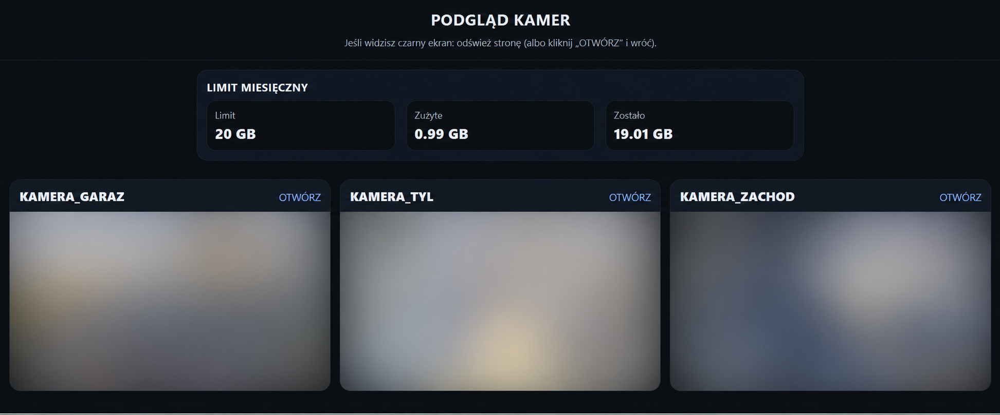
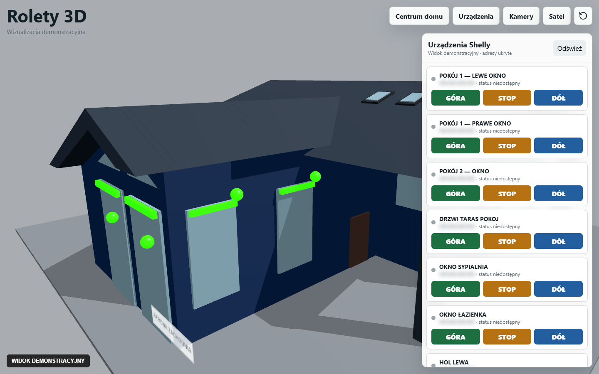
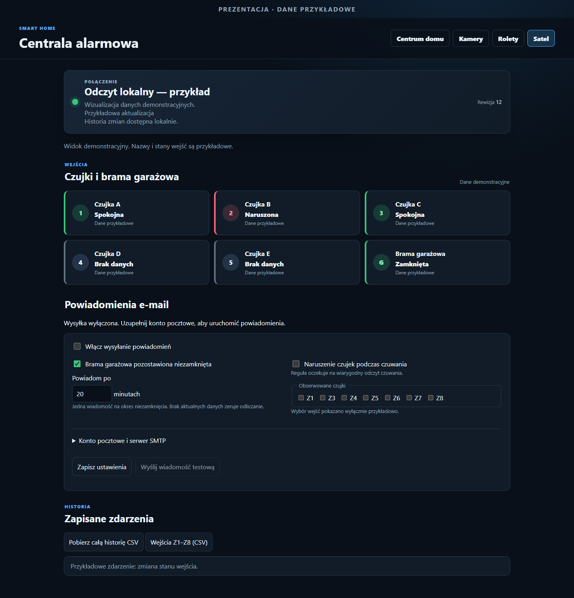

# Raspberry Pi Smart Home Dashboard

A personal home automation project developed as a hobby for a real home, bringing together camera monitoring, a 3D shutter dashboard and selected SATEL alarm system states.

The project started as a Raspberry Pi camera dashboard using nginx, go2rtc and a monthly network usage counter. It has since expanded to include a 3D shutter visualization and a local alarm status dashboard.

> This is an independent project and is not affiliated with SATEL. The repository includes the camera dashboard and selected SATEL helper modules; it does not contain the complete smart home application.

## Project overview

### Camera dashboard



This archived screenshot has been blurred for privacy. Its usage figures are historical and do not represent current usage.

### 3D shutter visualization



The 3D model comes from the local application. Some device labels have been changed for presentation, IP addresses are obscured, and current device states are not shown.

### Alarm dashboard



The alarm screenshots use fictional demonstration data. [View the mobile screenshot](assets/dashboard-mobile.png).

## Features

- Camera dashboard served locally by nginx, with go2rtc providing RTSP/WebRTC streams.
- Monthly RX/TX usage counter for a selected Raspberry Pi network interface.
- 3D visualization and controls for Shelly shutter devices in the private application.
- Display and history of selected alarm inputs in the private application.
- Helper modules for input states, SQLite event history and email notifications.
- Configurable delay for a garage door left unclosed. Sensor alerts while armed require a reliable source of the corresponding armed states and are not currently available as a complete feature.

## Repository structure

```text
rpi-go2rtc-dashboard/
├── README.md
├── assets/                  # Presentation screenshots
├── web/                     # Camera dashboard and usage example
├── go2rtc/                  # Example go2rtc configuration
├── systemd/                 # Services and usage counter timer
├── scripts/
│   ├── usage_monthly.sh
│   └── satel/               # Transport-independent modules and offline demo
└── tests/satel/             # Tests for SATEL helper modules
```

## Camera dashboard installation

1. Copy `web/index.html` to `/var/www/html/index.html`.
2. Copy `scripts/usage_monthly.sh` to `/usr/local/bin/usage_monthly.sh` and make it executable:

   ```bash
   sudo chmod +x /usr/local/bin/usage_monthly.sh
   ```

3. Copy `systemd/usage-counter.service` and `systemd/usage-counter.timer` to `/etc/systemd/system/`.
4. Enable the timer:

   ```bash
   sudo systemctl daemon-reload
   sudo systemctl enable --now usage-counter.timer
   ```

5. Configure go2rtc using `go2rtc/go2rtc.yaml.example` and `systemd/go2rtc.service.example` as starting points. Keep real camera credentials outside the repository.

The original setup uses Tailscale for VPN access. `usage_monthly.sh` counts RX and TX bytes on a selected Raspberry Pi network interface, `tailscale0` by default. This is not necessarily the total SIM card usage reported by the router or mobile operator; interface counter resets can also affect the result.

## SATEL helper modules

The files in `scripts/satel/` manage input states, a local SQLite history and email notifications independently of the transport. The included demo uses fictional observations and requires Python 3.10 or newer, with no additional dependencies:

```bash
python scripts/satel/demo.py
```

Run the tests from the module directory:

```bash
cd scripts/satel
python -m unittest discover -s ../../tests/satel -v
```

SMTP is mocked in the notification tests. Actual email delivery requires explicit SMTP configuration and integration with an application. The settings database can contain an SMTP password; keep it private and out of Git.

**The repository does not include RS-485 or USB-RS/RS-232 communication, the panel reader, protocol implementation or the complete shutters and alarm web interface.** It cannot connect to a SATEL panel on its own. A separate authorized adapter and application integration are needed. Input mappings are examples: the default gate rule uses Z2 and must be checked against the actual installation before use.

## Limitations

- The application records observed state changes, not the complete internal event memory of the alarm panel. Short events between polls and events during an outage can be missed.
- Panel restart recovery and controlled physical tests of the sensors and garage door still require verification.
- Alerts for sensor violations while armed require confirmed armed-state information for the relevant zones. The published helper modules do not provide that information.
- This is an experimental project and does not replace the alarm panel or its official safety functions.

SATEL and INTEGRA are names of their respective owners. Manufacturer information: [DLOADX](https://www.satel.pl/produkty/sswin/programy/programowanie/dloadx/) and [INTEGRA integration](https://www.satel.pl/kategoria-produktu/integracja/).
