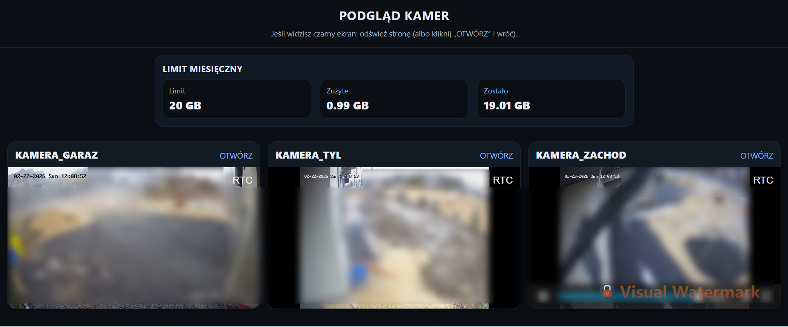

# rpi-go2rtc-dashboard

Camera dashboard on Raspberry Pi: nginx + go2rtc + monthly data usage counter.



## What's included
- `go2rtc` as an RTSP/WebRTC proxy (with `on_demand` streams)
- `nginx` serves `web/index.html` and `usage.json`
- `usage_monthly.sh` writes monthly usage data to `/var/www/html/usage.json`
- `systemd` timer runs the usage counter every minute

## Repository structure
```text
rpi-go2rtc-dashboard/
|- README.md
|- web/
|  |- index.html
|  `- usage.json.example
|- scripts/
|  `- usage_monthly.sh
|- systemd/
|  |- usage-counter.service
|  |- usage-counter.timer
|  `- go2rtc.service.example
`- go2rtc/
   `- go2rtc.yaml.example
```

## Installation (short)
1. Copy `web/index.html` to:
   - `/var/www/html/index.html`
2. Copy `scripts/usage_monthly.sh` to:
   - `/usr/local/bin/usage_monthly.sh`
   - `sudo chmod +x /usr/local/bin/usage_monthly.sh`
3. Copy `systemd/usage-counter.*` to:
   - `/etc/systemd/system/`
4. Enable timer:

```bash
sudo systemctl daemon-reload
sudo systemctl enable --now usage-counter.timer
```

5. go2rtc:
   - config: `/etc/go2rtc/go2rtc.yaml` (see `go2rtc/go2rtc.yaml.example`)
   - service: `systemd/go2rtc.service.example`

Tailscale was used to tunnel VPN access.
